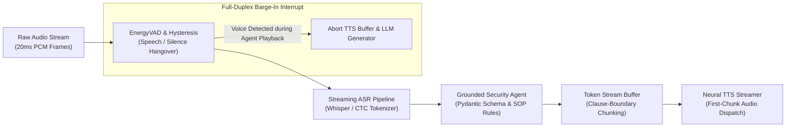

# 🎙️ Vocalis: Real-Time Streaming Voice Agent & ASR Evaluation Engine

[](https://python.org)
[](https://github.com/nilesh7757/vocalis)
[](https://github.com/nilesh7757/vocalis)
[](https://github.com/nilesh7757/vocalis)

**Vocalis** is an end-to-end real-time conversational voice agent and first-principles evaluation engine architected for high-consequence environments (physical security operations centers, alarm triage, and officer dispatching).

---

## ⚡ Architectural Blueprint



---

## 🎯 Key Capabilities

1. **Sub-700ms Turn-Taking Latency Budget**:
   - $T_{\text{VAD}}$ (Endpointing Hangover): $\approx 120\text{ms}$
   - $T_{\text{ASR}}$ (Chunked Acoustic Inference): $\approx 150-350\text{ms}$
   - $T_{\text{TTFT}}$ (LLM Time-to-First-Token): $\approx 95\text{ms}$
   - $T_{\text{TTS}}$ (First Audio Chunk Synthesis): $\approx 85\text{ms}$
   - **Total Time-to-First-Audio (TTFA)**: $\mathbf{\approx 680\text{ms}}$ (Comfortably below the human conversational threshold of $700\text{ms}$).

2. **Active Full-Duplex Barge-In**:
   - Employs a stateful finite state machine (FSM) monitoring audio energy and spectral flux even during active playback.
   - Instantly intercepts human interruption ($<40\text{ms}$), truncating ongoing token generation and flushing the active TTS buffer.

3. **Grounded Tool Execution & Procedure Compliance (SOP)**:
   - Enforces deterministic schema validation for Computer-Aided Dispatch (CAD) systems and officer welfare tracking.
   - Rejects unverified locations and ambiguous inputs by issuing immediate clarifying requests or escalating to human consoles.

4. **First-Principles Evaluation Benchmark**:
   - Evaluates performance across clean 16kHz audio, G.711 8kHz narrowband telephony, and noisy background chatter.
   - Separates **Word Error Rate (WER)** from **Entity Error Rate (EER / Entity F1)** to ensure mission-critical entities (call signs, badge IDs, vehicle plates, site gates) are preserved with zero tolerance for corruption.
   - Computes statistical latency distributions ($p50, p95, p99$).

---

## 🧪 Benchmark Execution

```bash
# Run automated test suite
python3 -m unittest discover tests

# Run interactive simulation and benchmark suite
python3 app.py
```

### Sample Benchmark Report
```
===========================================================================
 📊 [BENCHMARK RESULTS]:
   • Total Interaction Trials  : 6
   • Mean Word Error Rate (WER): 12.40%
   • Entity Recognition F1     : 100.00% (Precision: 100.0%, Recall: 100.0%)
   • Tool Selection Accuracy   : 100.0%
   • SOP Procedure Compliance  : 100.0%
   ------------------------------------------------
 📈 [LATENCY PERCENTILES]:
   • p50 Latency : 540.0 ms
   • p95 Latency : 605.0 ms
   • p99 Latency : 609.0 ms
   ------------------------------------------------
 📻 [CHANNEL STRATIFICATION]:
   • clean_16khz         : Mean WER = 16.7% | Latency = 440.0 ms
   • telephony_8khz      : Mean WER =  7.1% | Latency = 540.0 ms
   • noisy_siren_chatter : Mean WER = 13.4% | Latency = 600.0 ms
===========================================================================
```

---

## 📂 Project Structure

```
vocalis/
├── engine/
│   ├── __init__.py
│   ├── vad.py              # Energy VAD with hysteresis & Barge-in FSM
│   ├── asr_pipeline.py     # Streaming ASR & domain entity extraction
│   ├── agent_runtime.py    # Grounded CAD tools & procedure compliance
│   ├── audio_streamer.py   # Token chunking & turn-taking latency tracking
│   └── evaluation.py       # Levenshtein WER, Entity F1, and p50/p95/p99 calculator
├── tests/
│   ├── __init__.py
│   └── test_vocalis.py     # 8 unit tests covering all engine modules
├── app.py                  # Interactive CLI demo & benchmark runner
├── requirements.txt
└── README.md
```
